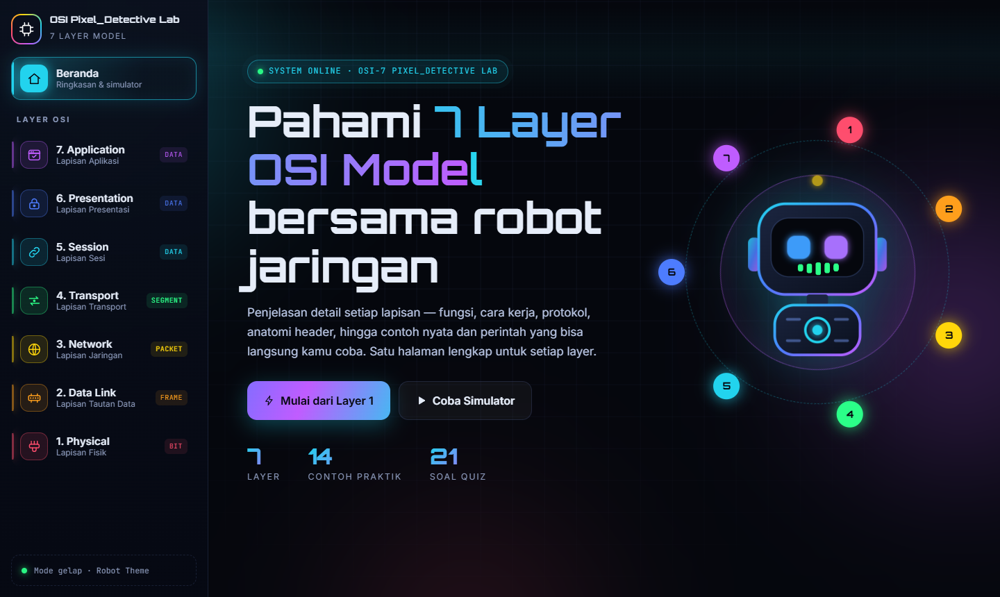
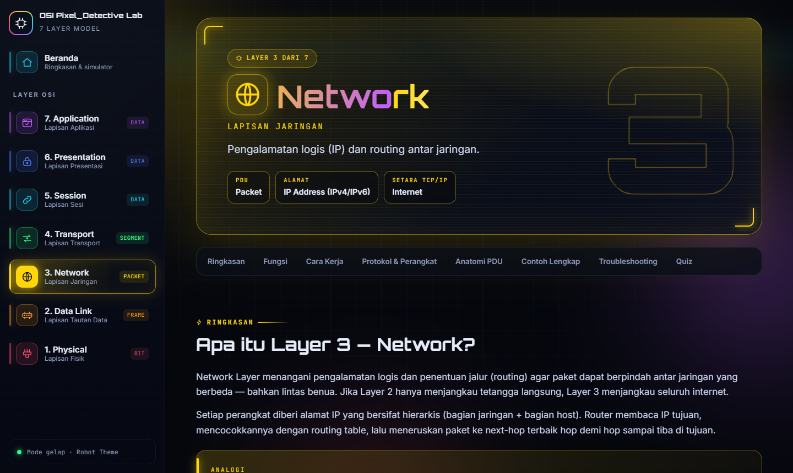
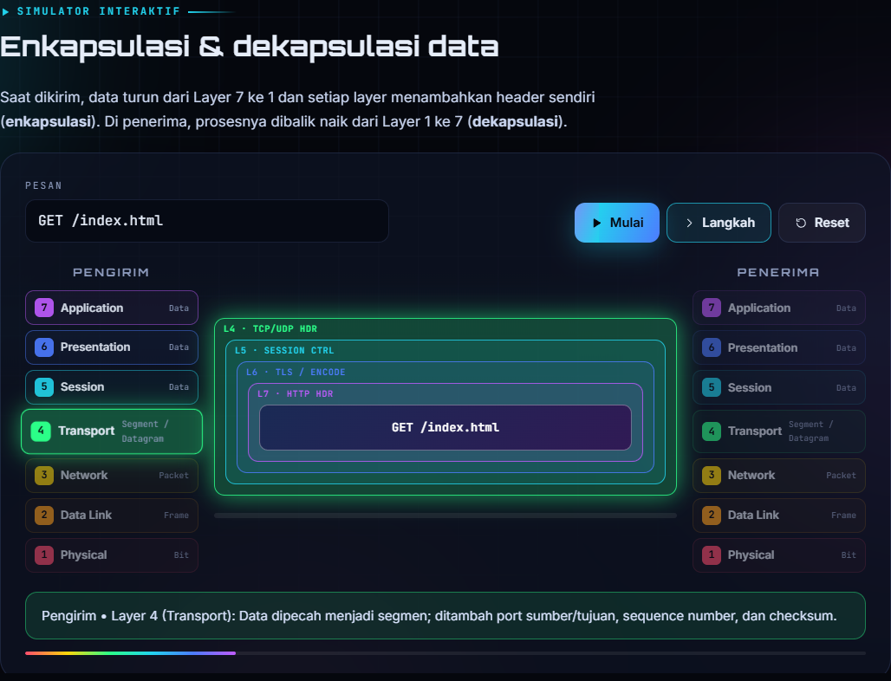
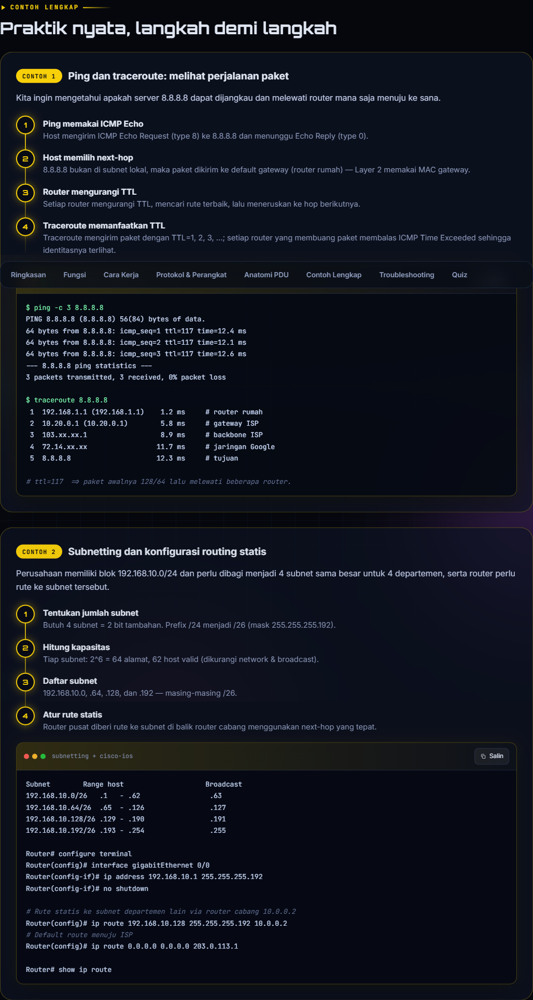
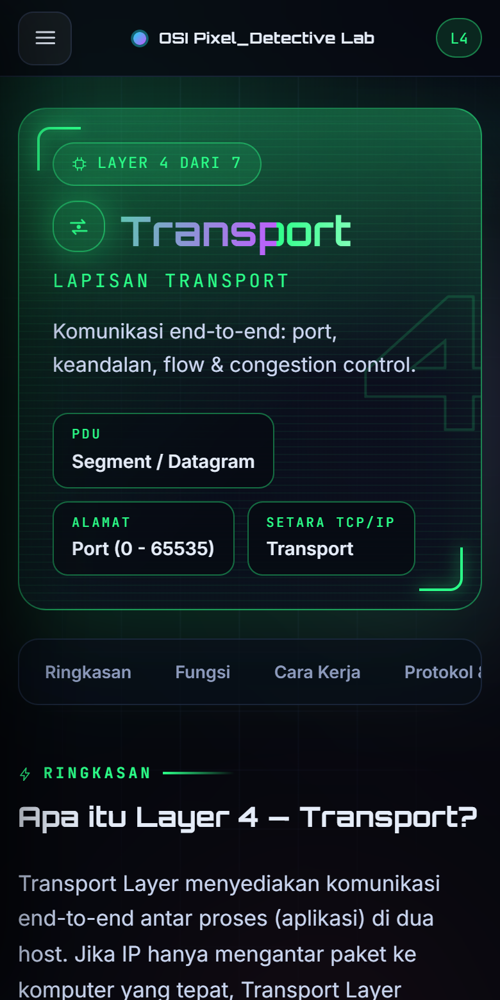

<div align="center">



# 🕵️‍♂️ OSI Pixel_Detective Lab

**Belajar 7 Layer OSI Model dengan cara interaktif — tema dark robot, animasi warna, dan contoh praktik nyata di setiap layer.**

[](https://floryid.github.io/osilayer/)
[](https://github.com/floryid/osilayer/actions)


</div>

---

## ✨ Fitur Utama

| | Fitur | Keterangan |
|---|---|---|
| 🧱 | **7 halaman layer** | Satu file React per layer, dari Physical sampai Application |
| 📖 | **Penjelasan detail** | Ringkasan, analogi, 6 fungsi utama, dan mekanisme "cara kerja" |
| 🧬 | **Anatomi PDU interaktif** | Klik tiap field header (Ethernet, IPv4, TCP, TLS Record, HTTP, dll.) |
| 🧪 | **2 contoh praktik per layer** | Langkah demi langkah + perintah / konfigurasi yang bisa disalin |
| 🛠️ | **Troubleshooting** | Masalah umum, solusi, dan perintah diagnosis |
| 🎯 | **Quiz** | 3 soal per layer dengan penjelasan jawaban |
| 🎬 | **Simulator enkapsulasi** | Lihat data dibungkus di pengirim dan dibuka di penerima |
| 🧠 | **Mnemonic & OSI vs TCP/IP** | Alat bantu menghafal dan membandingkan model |
| 🎨 | **Warna per layer** | Tiap menu punya warna & animasi glow sendiri |
| 📱 | **Responsive** | Sidebar di desktop, menu geser di tablet & HP |

## 🌈 Peta Layer

| # | Layer | PDU | Warna | Fokus |
|:-:|-------|-----|:-----:|-------|
| 7 | **Application** | Data | 🟣 | HTTP, DNS, SMTP, SSH |
| 6 | **Presentation** | Data | 🔵 | TLS, encoding, kompresi |
| 5 | **Session** | Data | 🩵 | Sesi, cookie, token |
| 4 | **Transport** | Segment | 🟢 | TCP, UDP, port |
| 3 | **Network** | Packet | 🟡 | IP, routing, ICMP |
| 2 | **Data Link** | Frame | 🟠 | MAC, switch, VLAN |
| 1 | **Physical** | Bit | 🔴 | Kabel, sinyal, Wi-Fi |

## 📸 Tampilan

<div align="center">



<br /><br />



<br /><br />



<br /><br />



</div>

## 🚀 Menjalankan Secara Lokal

Prasyarat: [Node.js](https://nodejs.org/) 18 atau lebih baru.

```bash
git clone https://github.com/floryid/osilayer.git
cd osilayer
npm install
npm run dev        # http://localhost:5173
```

Perintah lain:

```bash
npm run build      # build produksi ke dist/
npm run preview    # pratinjau hasil build
```

## 🗂️ Struktur Proyek

```text
src/
├── layers/                 # satu file per layer OSI
│   ├── Layer1Physical.jsx
│   ├── Layer2DataLink.jsx
│   ├── Layer3Network.jsx
│   ├── Layer4Transport.jsx
│   ├── Layer5Session.jsx
│   ├── Layer6Presentation.jsx
│   └── Layer7Application.jsx
├── components/             # LayerView, Simulator, Quiz, PDU diagram, ikon, robot
├── pages/Home.jsx          # beranda: peta layer, simulator, mnemonic
├── data/layersMeta.js      # nama, warna, PDU, dan deskripsi enkapsulasi tiap layer
└── styles/                 # base, layout, components, layer, home (CSS murni)
```

## 🧩 Menambah atau Mengubah Konten

Seluruh materi sebuah layer berupa satu objek `data` di dalam file layer-nya
(`summary`, `functions`, `deep`, `protocols`, `devices`, `pdu`, `examples`,
`troubleshooting`, `facts`, `quiz`). Ubah teksnya, simpan, dan halaman otomatis
ter-render ulang. Warna dan nama layer diatur di `src/data/layersMeta.js`.

## 🌐 Deploy

Setiap push ke `main` otomatis dibuild dan dipublikasikan ke **GitHub Pages**
lewat [`deploy.yml`](.github/workflows/deploy.yml).

Pengaturan awal (cukup sekali): **Settings → Pages → Build and deployment → Source: GitHub Actions**.

## 🛠️ Teknologi

- [React](https://react.dev/) 19 (lazy loading per layer)
- [Vite](https://vite.dev/) 7
- CSS murni: custom properties, `@property` untuk border animasi, backdrop-filter, `prefers-reduced-motion`
- Font: Orbitron, Inter, JetBrains Mono
- Routing berbasis hash, jadi aman di GitHub Pages tanpa konfigurasi tambahan

## 📄 Lisensi

Proyek ini dibuat untuk tujuan edukasi. Silakan gunakan dan kembangkan sesuai kebutuhan.

<div align="center">

Dibuat dengan 💙 untuk siapa saja yang ingin memahami jaringan komputer.

</div>
